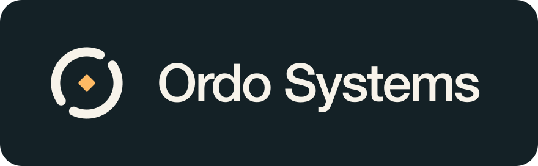

# KeenProxy

Selective traffic routing for Keenetic and Netcraze routers running Entware, with an embedded [sing-box](https://github.com/SagerNet/sing-box) engine and a Vue web interface.

KeenProxy lets you choose which devices, domains, IP ranges, and countries use a tunnel, connect directly, or are blocked. It is an experimental project under active development. Router compatibility and protocol support depend on the firmware, kernel modules, and build tags.

## Documentation and live demo

- [English documentation](https://ordo-systems.github.io/keen-proxy/) · [Russian documentation](https://ordo-systems.github.io/keen-proxy/ru/)
- [Interactive browser demo](https://ordo-systems.github.io/keen-proxy/demo/) — the same interface with synthetic data and an in-memory API; no router required. Changes reset on reload.

## What works today

- Device and network policies: split routing, full tunneling, direct access, and per-device overrides identified by MAC address.
- Domain, IP/CIDR, and country groups, including country exclusions. Within routed policies, explicit domain/address rules precede country rules; global block groups are applied first.
- Domain detection from TLS SNI or HTTP Host, with a bounded IPv4 DNS-answer cache as a fallback when the connection has no readable hostname.
- WireGuard, supported sing-box connection links, raw sing-box outbounds/endpoints, and an optional external TrustTunnel client.
- Connection failover with recovery hysteresis and explicit direct fallback where configured.
- A UDP/TCP DNS frontend, public resolver presets, DoH/DoT, selectable DNS routing, and DNS-only blocklists.
- Community domain presets with preview and managed updates that preserve manual additions and exclusions.
- YAML configuration, a shared draft/Apply workflow, import/export, and a previous-configuration backup.
- Dark/light themes, responsive navigation, connection wizards, file import, and bulk group route changes.
- Routing, audit, and system journals; connection statistics; and separate HTTP, verified HTTPS, and bounded transfer diagnostics.

## How routing works

The compiler combines configuration and discovered LAN addresses into sing-box rule sets and a firewall plan. The daemon starts the required services before enabling interception and removes interception first during shutdown.

TCP uses REDIRECT. The `tproxy` mode also enables UDP TPROXY. Client-specific policies take precedence over network policies. Within a routed policy, a country exclusion is applied after explicit domain and address rules. Global blocking rules, including country blocks, are evaluated before those policies.

Readable hostnames remain the primary routing signal. DNS-derived IP rules are used only when no hostname is available. This fallback depends on observed/resolved answers and TTLs; it cannot reliably recover hidden names from ECH or a device's independent encrypted DNS cache.

## Build and try the interface

Requirements:

- Go **1.26.1** or the compatible toolchain selected by `go.mod`.
- Node.js **22.12+** (or another Vite-compatible version) and npm.
- Docker for the network-namespace integration suite.
- For a router: Entware, supported Linux kernel facilities, and compatible iptables tools.

From the repository root:

```sh
make ui-demo
```

Open `http://127.0.0.1:8086/`. Demo mode uses synthetic traffic and keeps configuration changes in memory; it does not configure host routing or a firewall. The initial token is printed to the terminal and stored at the path specified in `examples/demo.yaml`.

For frontend development, keep the demo API running and use a second terminal:

```sh
cd web
npm ci
npm run dev
```

The development server proxies `/api` to `http://127.0.0.1:8086`. Set `KEENPROXY_URL` to use a different local backend.

```sh
make build               # Host binary with the embedded UI
make build-router        # Linux ARM64 and MIPS little-endian builds
make build-router-lite   # Smaller protocol set for constrained routers
```

The full build enables QUIC, uTLS, WireGuard, and gVisor. The lite registry excludes several protocols; see `internal/engine/registry_lite.go`. Xray's XHTTP transport is not supported.

## Configuration and router installation

The bilingual documentation source is in [docs/en/index.md](docs/en/index.md) and [docs/ru/index.md](docs/ru/index.md), including an illustrated user guide. A separate browser demo is built from the same Vue interface with an in-memory API adapter; see [documentation build instructions](docs/en/development.md).

Start with [examples/config.yaml](examples/config.yaml) and [examples/connections.yaml](examples/connections.yaml). Example keys, addresses, and credentials are placeholders and must be replaced. Keep real configuration files and support exports out of Git.

The default paths are:

| Item | Default |
| --- | --- |
| Configuration | `/opt/etc/keenproxy/config.yaml` |
| API token | `/opt/etc/keenproxy/token` |
| Rule sets and derived state | `/opt/var/lib/keenproxy/` |
| API listener | Defined by `api.listen` |

On a prepared Entware router, install `curl` and a CA bundle if needed. Run these commands from the Entware root shell. [Router preparation guide](docs/en/getting-started.md#prepare-the-router)

```sh
opkg update && opkg install curl ca-bundle ca-certificates
curl -fsSL https://raw.githubusercontent.com/ordo-systems/keen-proxy/main/tools/bootstrap.sh | /opt/bin/sh
```

The bootstrap reads `version.txt` from `main`, selects the ARM64 or MIPSLE asset, and verifies the binary and installer files against the tagged release's `SHA256SUMS`. It installs missing Entware `iptables` tools, installs the pinned TrustTunnel client by default, and registers and starts `/opt/etc/init.d/S99keenproxy`. Entware runs the init script on boot. The first start enables LAN DNS interception even with an empty routing policy. Stop any competing interceptor first.

Run the same command again to update. Existing configuration and tokens are preserved. Select a specific published release with `--version`, choose the smaller build with `--lite`, or skip the optional client with `--without-trusttunnel`:

```sh
curl -fsSL https://raw.githubusercontent.com/ordo-systems/keen-proxy/main/tools/bootstrap.sh | /opt/bin/sh -s -- --version vX.Y.Z --lite --without-trusttunnel
```

Replace `vX.Y.Z` with a real release tag. The release must contain the binary, `install.sh`, `S99keenproxy`, and `SHA256SUMS`. If assets are still publishing, retry when they are available. Check or stop the service with `/opt/etc/init.d/S99keenproxy status` or `/opt/etc/init.d/S99keenproxy stop`.

To remove an installation managed by the bootstrap:

```sh
curl -fsSL https://raw.githubusercontent.com/ordo-systems/keen-proxy/main/tools/bootstrap.sh | /opt/bin/sh -s -- --uninstall
```

This stops KeenProxy and removes its binary and Entware init script. It keeps the configuration, API token, logs, rule sets, and optional TrustTunnel client. Reinstall with the regular install command to reuse the saved settings.

For offline or manual setup, `tools/install.sh` copies a supplied executable and optionally verifies and installs the pinned TrustTunnel client. It preserves configuration and leaves service setup to the operator. After copying the binary and installer to the router, run:

```sh
/opt/bin/sh /opt/tmp/install.sh \
  --binary /opt/tmp/keenproxy-linux-arm64 --without-trusttunnel
```

Omit `--without-trusttunnel` to install the pinned external TrustTunnel client as well. Its executable and license remain separate from KeenProxy. Review the installer before using it and use the target router's CA bundle when required.

Enabling interception changes live LAN traffic. Back up the router configuration, retain SSH access and a tested recovery path, and avoid running competing DNS/interception tools simultaneously. Even with no selected clients, the DNS frontend intercepts LAN port 53 when enabled. Inspect a candidate configuration before starting:

```sh
./bin/keenproxy -dry-run -config /path/to/config.yaml
```

The dry-run output contains generated connection settings and may include secrets. Do not post it publicly without review.

## Validation

```sh
CGO_ENABLED=0 make test
CGO_ENABLED=0 make vet
cd web && npm test && npm run build
```

Run `make integration` separately for real DNS/firewall/tunnel tests in disposable Docker network namespaces. It uses a privileged container to create those namespaces; it does not target your router. Auxiliary Go tools under `tools/bench` and `tools/nlprobe` are separate modules.

## Known limits

- IPv4 routing is the current focus. Filtering AAAA responses is not a complete IPv6 leak-prevention policy.
- A successful periodic HTTP probe proves only that request. It does not certify HTTPS downloads, all destinations, or the actual DNS route.
- DNS protection depends on the chosen route and failure policy; configuration alone does not prove the absence of DNS leaks.
- Country data is approximate, and DNS-based routing may be ambiguous on shared/CDN addresses.
- Rule-set file updates are reloaded asynchronously. A written file does not prove immediate packet-level application.
- WireGuard file import accepts the supported single-peer subset. Unsupported options, commands, and multiple peers are rejected.
- Firewall recovery uses a polling watchdog; complete firmware hook integration and hardware fast-path acceleration are not claimed.
- Full-tunnel behavior, kernel features, memory use, and external client compatibility need validation on each router model.

## Contribute

Contributions to router compatibility, tests, documentation, localization, diagnostics, and accessibility are welcome. Read [CONTRIBUTING.md](CONTRIBUTING.md), [AGENTS.md](AGENTS.md), and [SECURITY.md](SECURITY.md) before sharing code or diagnostic material. English is the working language for developer documentation and code comments; the interface supports English and Russian.

Maintainers should also read [RELEASING.md](RELEASING.md) before publishing a repository or binary.

Internal work reports and local agent memories are intentionally excluded from the public tree. Public documentation describes supported behavior rather than a private router deployment.

## License and acknowledgements

KeenProxy's original source code is licensed under the **GNU General Public License, version 3 only** (`GPL-3.0-only`). See [LICENSE](LICENSE) for the complete terms. You may use, study, modify, and redistribute it under those terms; distributions must preserve applicable notices and satisfy the license's corresponding-source requirements. The software comes without warranty.

Third-party software and data retain their own licenses; see [THIRD_PARTY_NOTICES.md](THIRD_PARTY_NOTICES.md). In particular, sing-box is GPL-3.0-or-later, and the default DB-IP Lite country database requires attribution: [IP Geolocation by DB-IP](https://db-ip.com/). Other built-in country databases are listed with their terms in the notices.
