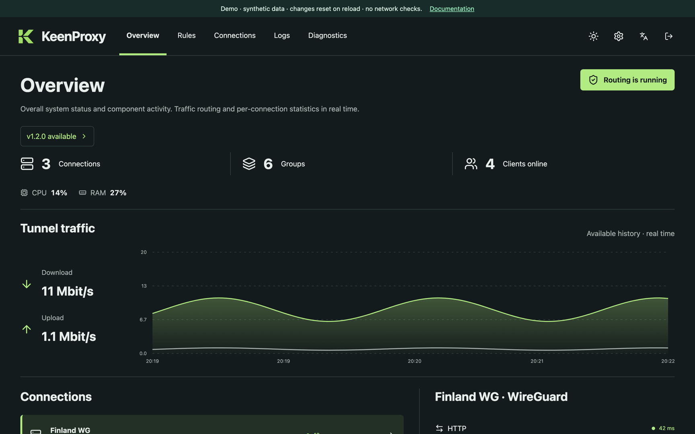
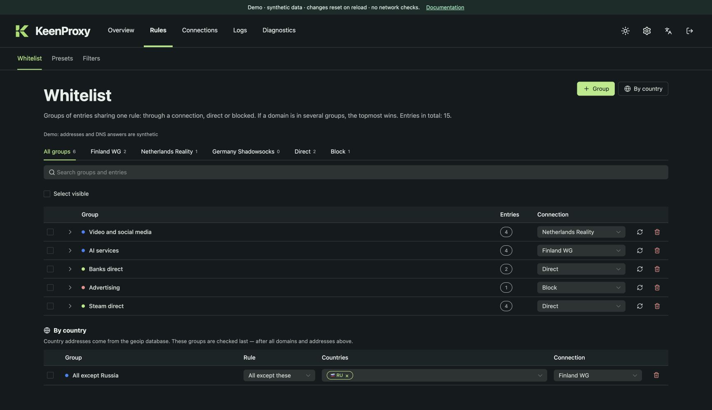
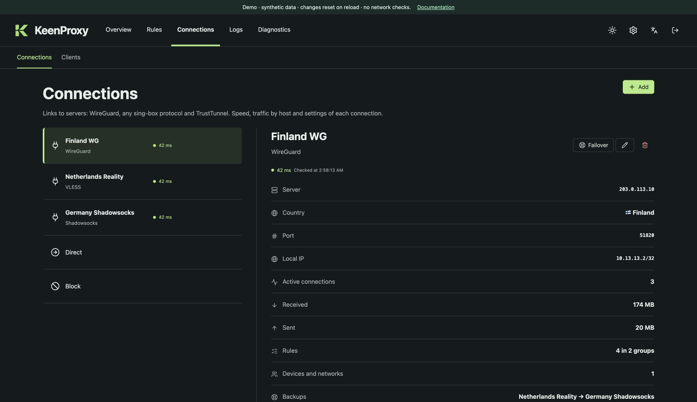
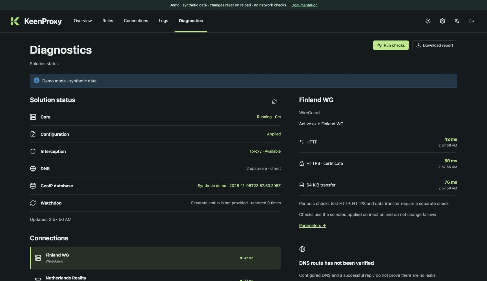

<section class="kp-hero" markdown>

{ .kp-hero__logo width="72" }

# Your network, your routes

Selective traffic routing for Keenetic and Netcraze routers running Entware. Choose which devices, domains, addresses, and countries use a tunnel, connect directly, or are blocked — from one web panel.

[:material-play: Try the demo](demo/){ .md-button .md-button--primary }
[Get started](getting-started.md){ .md-button }

[{ .kp-hero__shot }](demo/)

</section>

<section class="kp-section" markdown>

## What it does

:material-devices:{ .kp-card__icon }

### Device and network policies

Split routing, full tunneling, or direct access per network, with per-device overrides by MAC address.

:material-earth:{ .kp-card__icon }

### Domain, IP, and country groups

Route by domain, CIDR, or country — including exclusions such as “everything except Russia”.

:material-vpn:{ .kp-card__icon }

### Many connection types

WireGuard, sing-box connection links, raw sing-box outbounds, and an optional TrustTunnel client.

:material-shield-sync:{ .kp-card__icon }

### Failover

Fall back to another connection when one goes down, and return after it has recovered.

:material-dns:{ .kp-card__icon }

### DNS and blocklists

A local DNS frontend with DoH/DoT resolvers, selectable DNS routing, and DNS-only blocklists.

:material-file-document-check-outline:{ .kp-card__icon }

### Review before Apply

Every change goes into one shared draft. Apply it when ready, or discard it; journals explain the result.

</section>

<section class="kp-section" markdown>

## How it works

### Add a connection

Import a WireGuard file or a connection link, or use the wizard.

### Define groups

Collect domains, addresses, or countries and pick where they go.

### Choose devices and Apply

Select which networks and clients follow the rules, then apply the draft.

</section>

<section class="kp-section" markdown>

## A look at the panel

<figure markdown>

<figcaption>Rules</figcaption>
</figure>

<figure markdown>

<figcaption>Connections</figcaption>
</figure>

<figure markdown>

<figcaption>Diagnostics</figcaption>
</figure>

</section>

<section class="kp-cta" markdown>

## Try it in your browser

The demo runs the real web panel with synthetic data. No router or credentials are required.

[:material-play: Open the demo](demo/){ .md-button .md-button--primary }
[Read the overview](overview.md){ .md-button }

KeenProxy is experimental. Compatibility depends on the router architecture, firmware, kernel capabilities, and build features.

</section>

