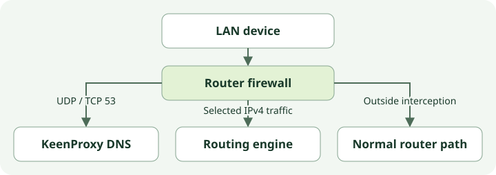
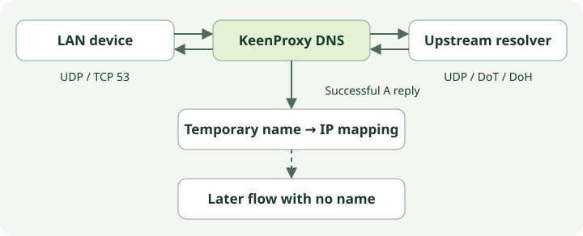
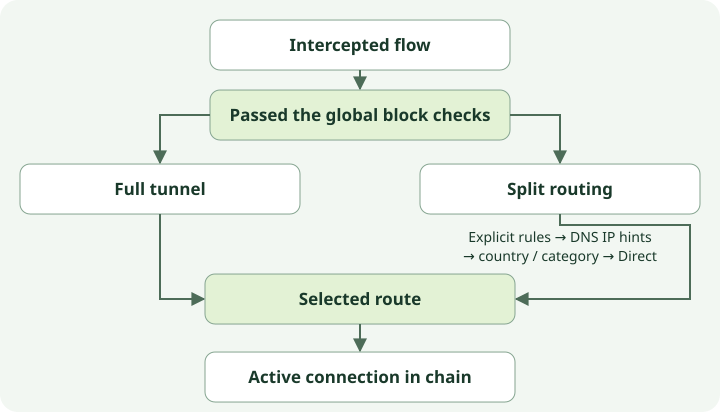

# How traffic flows through KeenProxy

This guide follows a DNS lookup and a connection from a LAN device through a Keenetic or Netcraze router. It explains which traffic KeenProxy sees, which rule chooses the exit, and where failures can occur.

## Where interception happens

KeenProxy runs on the router. Devices keep their usual LAN gateway and can use ordinary DNS and application connections. When an IPv4 packet enters the configured LAN interface, the router firewall decides whether to send it to a local KeenProxy listener or handle it normally.

| Traffic entering the LAN interface | What the router does |
| --- | --- |
| UDP or TCP to port 53 | Redirects it to the KeenProxy DNS frontend, even when the device addresses the router itself or a public DNS server. This rule applies on the configured interface independently of device routing policy. |
| TCP from a participating source to a destination outside the bypass ranges | Uses REDIRECT to hand the connection to sing-box. The engine can recover the original destination and open a separate outbound connection. |
| Other UDP from a participating source | In TPROXY mode, eligible packets are marked and policy routing delivers them locally without rewriting the destination. In REDIRECT mode, ordinary UDP is outside application interception. |
| Forwarded UDP to port 443 from a participating source | Rejected in either mode. Browsers commonly retry over TCP, but an application that requires QUIC may fail. |
| Traffic outside the configured scope | Follows the router's usual path. Examples include bypassed local ranges for application traffic and IPv6, which this IPv4 interception does not cover. Traffic switched directly between LAN devices may never reach these firewall rules. |

A network policy matches the source subnet. A device override is configured by MAC address and matched using its current IPv4 address learned through the router's neighbor table, or a configured static address. **Not included** excludes the device from application interception. It does not exempt it from the interface-wide DNS rule. Locally originated router traffic does not arrive through the LAN interception rules.

On startup, KeenProxy brings up the engine and DNS listeners before installing interception. On a normal shutdown it removes interception first. While running, it checks whether the router has removed its firewall rules and attempts to restore them. An intentional shutdown returns traffic to the router's usual forwarding rules, so it is distinct from a tunnel failing while KeenProxy is still running.

## DNS and the application connection are separate

1. The DNS frontend receives the query. A matching DNS block can produce a local answer before contacting an upstream. When suppression of AAAA answers is enabled, the frontend can also return an empty IPv6 address response.
2. Otherwise, the frontend tries the configured resolvers in order. UDP, DNS over TLS (DoT), and DNS over HTTPS (DoH) are transports for the **router-to-resolver** leg. The device-to-router leg can still be ordinary DNS. An explicit DNS policy can send upstream queries directly or through a selected connection. The bootstrap IP for a named resolver lets the router connect without first resolving that hostname through another resolver, while TLS still verifies the configured server name.
3. If the DNS connection uses a fallback chain, the frontend follows its selected tunnel. If the chain selects Direct, the DNS frontend rejects that exit. It tries the resolvers directly only when DNS policy explicitly allows direct fallback. Otherwise, a failed connection path returns a DNS error. Older configurations without an explicit DNS route can have a separate system-resolver fallback.
4. The frontend returns the answer to the client. Successful IPv4 answers can populate a short-lived name-to-address mapping, including addresses reached through CNAME aliases. KeenProxy also resolves active configured names in the background. These addresses expire according to DNS TTLs. The engine reloads the derived rules asynchronously, so a cache change may take a short time to affect traffic.

The next application connection carries its own destination IP and port. It may expose a hostname in an unencrypted HTTP Host header or TLS SNI. KeenProxy uses that name for matching while preserving the original destination. The DNS-derived IP rules are eligible only when the connection has **no readable hostname**. If a name is visible but matches no domain rule, KeenProxy does not retry domain matching by IP from DNS. Shared CDN addresses, stale answers, and resolvers invisible to the frontend make address inference imperfect.

## How the routing engine chooses the exit

1. The engine inspects the beginning of an intercepted flow for a usable name. It bypasses private destinations and then applies global block rules to the remaining traffic. These checks precede device and network routing.
2. A device override takes precedence over its network policy. **Full tunnel** selects the configured connection after the global checks. **Split** evaluates explicit domain and IP groups first, then DNS-derived IP matches for unnamed flows, then country and category groups. Unmatched split traffic goes Direct.
3. The selected route can open a direct connection or use a proxy or tunnel. A direct connection opened by the engine and a packet that bypassed interception can both exit without a VPN, but only the former passed through the engine's routing decision. For a tunnel or proxy route, the router connects to the configured remote endpoint, which carries or relays traffic toward the original destination.

For example, suppose **Store → Direct** matches an explicit domain, and a broader country rule sends traffic outside a selected country through a tunnel. A connection whose TLS SNI is `store.example` matches the explicit rule first. A second connection to the same IP with no readable name can still match Store if KeenProxy has a usable DNS mapping. Without that mapping or an explicit IP rule, the country rule may win. When ECH exposes an outer SNI, that visible name can prevent DNS fallback even though the real inner name is hidden.

## What changes when a connection fails

A route can point to a connection with an ordered fallback chain. The rule still chooses the same logical target, while KeenProxy changes which member of that chain carries traffic. It periodically sends an HTTP request through each connection. After the active member has failed for the configured time, KeenProxy selects the first available alternative. It returns to a higher-priority member only after sustained success. If no alternative is available, it keeps the current selection. Direct is an eligible exit only if it was explicitly added to the chain.

Switching can close existing connections, so clients may need to reconnect. The probe reports reachability and response time for its test URL. It cannot establish that a particular website, UDP application, or DNS resolver works through the same connection.

## How to trace one request { #how-to-trace-one-request }

| What you want to establish | What to inspect |
| --- | --- |
| Which DNS path the router used | Compare the configured path in **Diagnostics** with direct-fallback events in **Logs → Audit**. Observe traffic on the router's external interface to verify the actual resolver path. Blocking TCP/UDP port 853, if enabled, does not catch application DoH over HTTPS on port 443. |
| Which rule and exit matched | Reproduce the request from the affected device and inspect **Logs → Routing** for the client, destination, rule, and outbound. A route decision can be logged even if the remote request fails. |
| Whether the connection works end to end | Run an HTTPS or transfer check and reproduce the failing application request. For DNS privacy, test from the actual device and observe the router's external traffic under both normal operation and tunnel failure. |

See [Routing and DNS](routing.md) for policy configuration and [Troubleshooting](troubleshooting.md) for additional checks.
