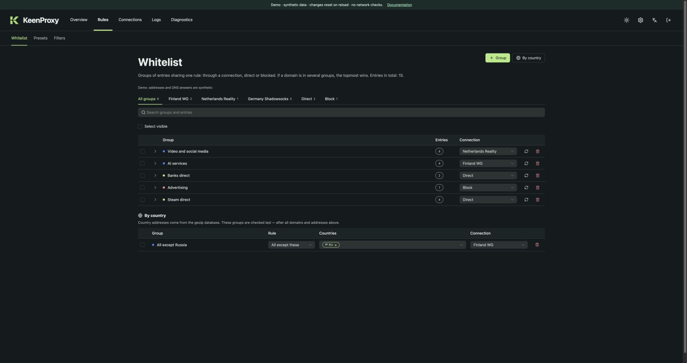
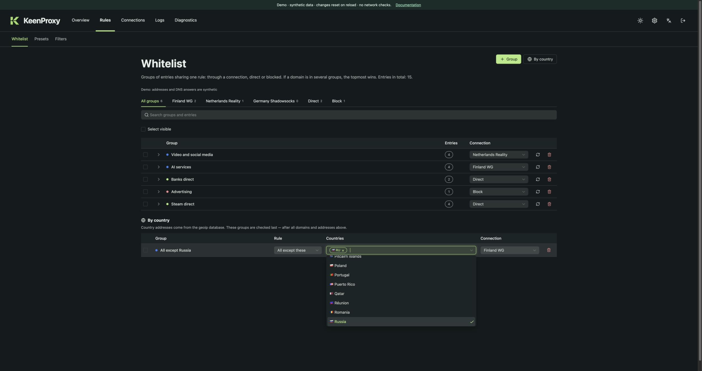

# Routing and DNS

## Policy building blocks

| Item | Purpose |
| --- | --- |
| Connection | A named tunnel/proxy profile that can be selected as a target |
| Group | A domain/address list or country selector with a target |
| Direct | Connect without a configured tunnel |
| Block | Reject matching traffic |
| Network | Default policy for a subnet |
| Client | Per-device policy identified by MAC address |

Country **Except** selectors describe traffic outside the listed countries. Explicit domain lists and country rules express different levels of policy; inspect the routing journal to confirm which rule actually won for a request.

## Country rules

Country groups match the **destination IP address** against the GeoIP database. They do not inspect the visitor's nationality, the website's language, or its domain suffix. A country selection also does not select an exit server: the **Connection** column chooses the route separately.

### Send everything except Russia through a tunnel

1. Create or import a working connection, then open **Rules → Whitelist**.
2. Choose **By country**. A new group starts with Russia (`RU`) selected and **All except these** enabled. Select the group name to rename it if needed.
3. In **Countries**, keep `RU`, or add more countries to exclude. Use **Only these countries** instead to match just the selected countries.
4. Set **Connection** to the desired profile, for example **Finland WG**. **Direct** bypasses the tunnel; **Block** rejects matching traffic.
5. Open **Connections → Clients** and ensure the relevant network or device uses **Split**. Review the shared draft and choose **Apply** once.

The browser demo already includes **All except Russia → Finland WG**. You can edit it, Apply, and reload to reset the synthetic session.

Open the country selector to search by country name or ISO code. Selected countries appear as code chips; removing a chip changes the draft.

### Understand which rule wins

Global block groups are evaluated first. For a routed device/network policy, explicit domain and address groups precede country groups. Device overrides take precedence over network defaults. **Full tunnel** uses its selected default connection and is a different policy from this split-routing recipe.

| Example with the demo configuration | Result |
| --- | --- |
| A Steam domain matches **Steam direct** | Direct, even if its destination is outside Russia |
| A domain matches **Video and social media** | Netherlands Reality, before the broad country rule |
| No earlier rule matches and the destination is outside `RU` | Finland WG |
| No earlier rule matches and the destination is in `RU` | The country exclusion does not match; the split policy falls back to Direct |

**All except these** is an inverted match, not a command that forces selected countries to Direct. An earlier explicit rule may still route a Russian destination through another connection. Keep specific exceptions in domain/address groups.

### Check the result

On a real installation, confirm that the country database is loaded in **Diagnostics**, Apply the configuration, and inspect **Logs → Routing** for the selected outbound and matching rule. Missing GeoIP data must be resolved before relying on country routing. CDN addresses and database updates can change an IP's assigned country; use explicit domains or addresses when that distinction matters.

The demo reports a synthetic loaded database and sample journal records. It demonstrates editing and Apply, but does not perform GeoIP lookups or verify real network traffic.

## Country databases

Country selectors use MMDB country databases, managed in **Rules → Country databases**. The list order is priority: the first enabled database that knows an address decides its country, and country rules follow the same precedence. Built-in sources can be enabled, disabled, and reordered. You can also add a custom database: an HTTPS link to `.mmdb`, `.mmdb.gz`, or `.tar.gz` (`{month}` expands to `YYYY-MM` and falls back to the previous month), or an absolute file path on the router.

The router checks enabled databases daily. Files are downloaded over HTTPS only, checked against a published SHA-256 digest when the source has one, validated as a country MMDB, and then swapped in atomically. A failed download keeps the previous file and is retried after 10 minutes, with the delay doubling up to 6 hours. Changing the database list triggers a check right after **Apply**.

Category databases are a second kind of IP database. Instead of countries, they label networks, for example `RU-BLOCKED`, `RE-FILTER`, or `TELEGRAM`. They never take part in country lookups. Groups select labels under **Categories**, alone or together with countries and **All except these**. Enabled category databases are combined, so a label matches if any of them reports it. The built-in runetfreedom sources publish each network under a single label, so a network that appears in several upstream lists matches only one of them. Category groups require at least one enabled category database.

Use **Check an address** to see which country each database reports. A disabled database can be downloaded and checked on its own without affecting routing. A check covers database contents only; it does not show which routing rule won for a real connection.

## Fallback chains

A connection can point to another connection or Direct as its immediate fallback. The interface displays the resulting chain. Edit the selected profile's immediate fallback; downstream inherited edges belong to their own profiles. Avoid cycles. Choosing Direct as a fallback intentionally allows a direct path when the primary connection fails.

Periodic health checks measure HTTP requests, not ICMP ping. They are separate from the manual HTTPS and transfer checks in Diagnostics.

## DNS

DNS settings choose upstream resolvers and whether requests travel directly or through a connection. Bootstrap addresses help resolve encrypted resolver hostnames. Failure policy controls whether a failed selected path may use direct DNS. Filter lists and exceptions change DNS answers, not every possible form of application traffic.

Use your router's actual network test procedure to evaluate UDP/TCP interception and encrypted-DNS handling. Applications can use their own resolvers. The UI and demo do not establish universal DNS-leak protection.

See the [user guide](user-guide.md) for screenshots and [Troubleshooting](troubleshooting.md) for interpreting evidence.
