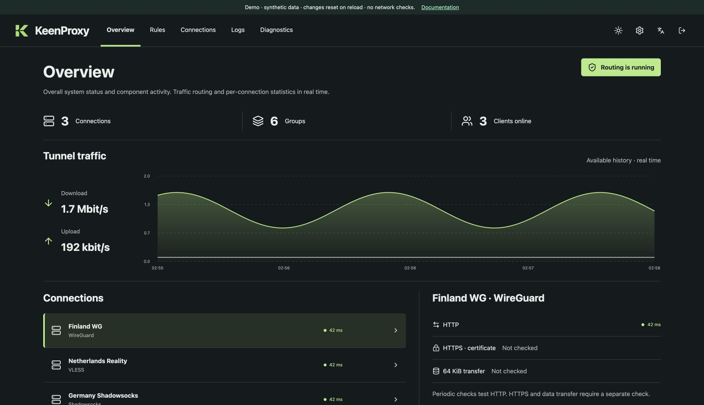
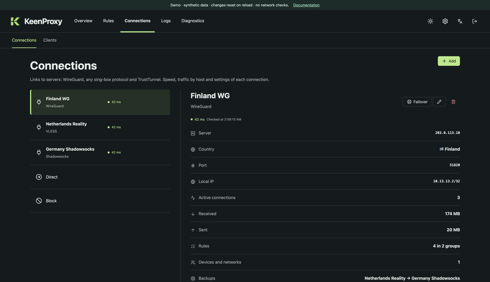
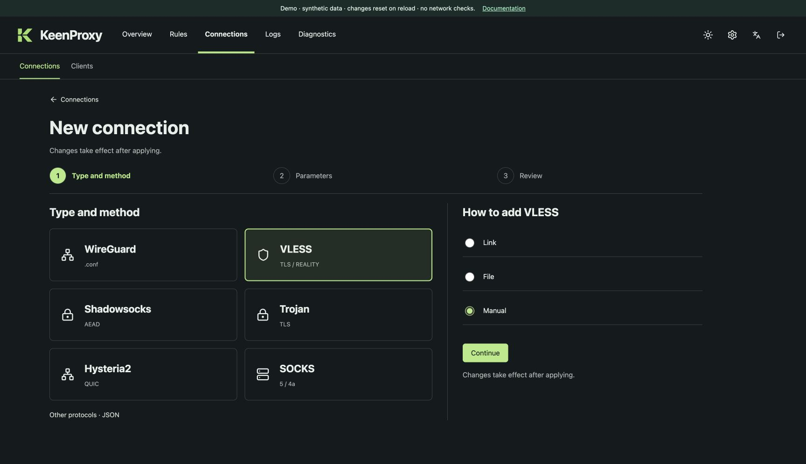
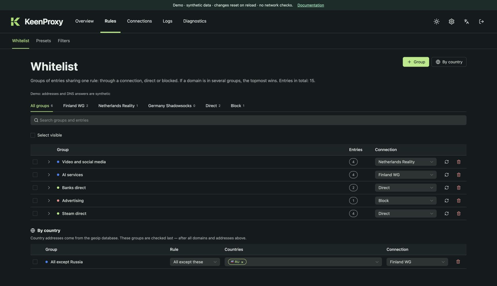
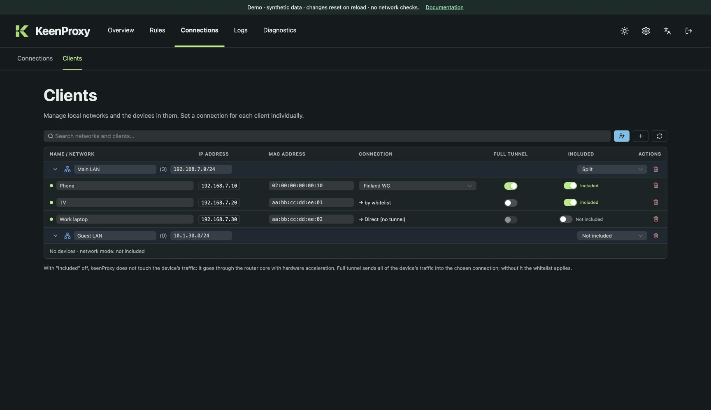
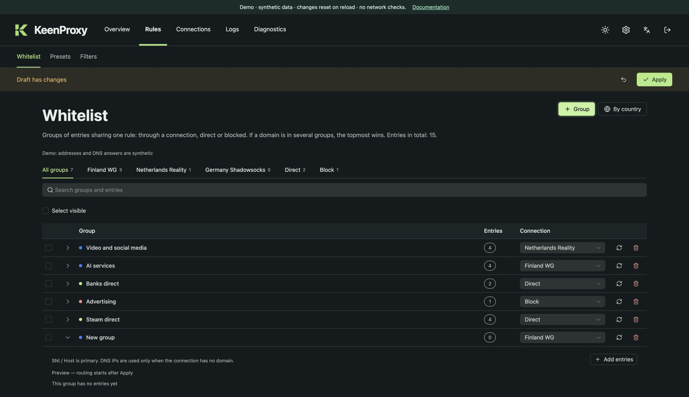
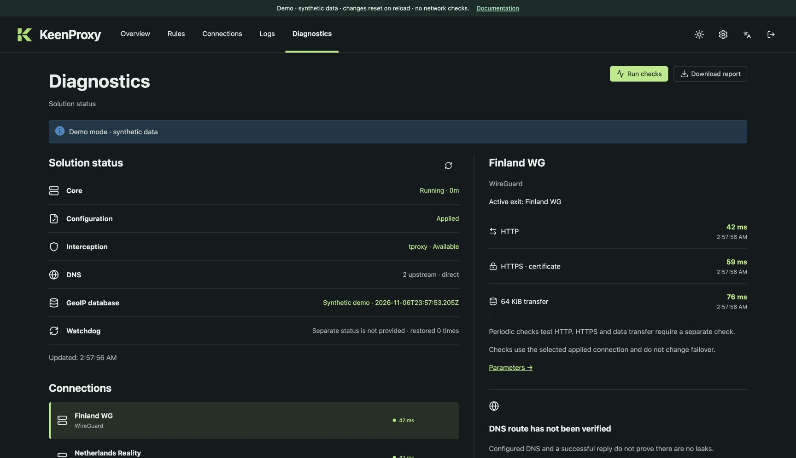
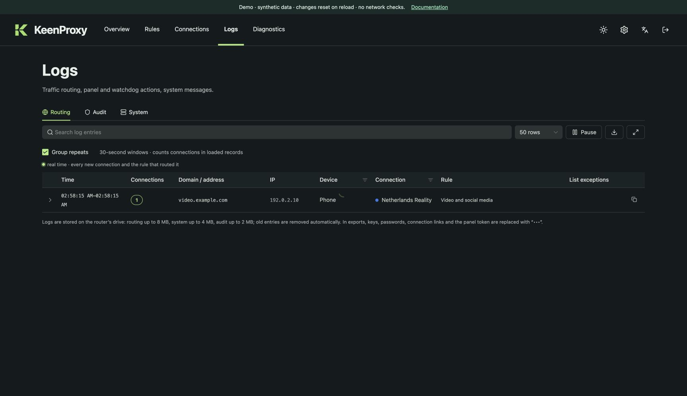
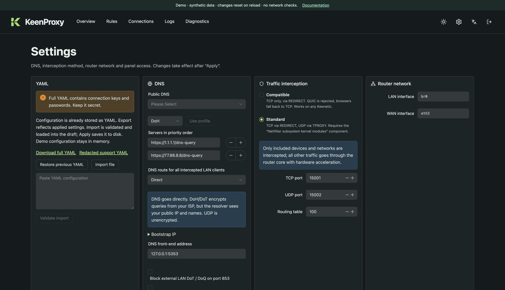

# User guide

These screenshots show the same Vue screens shipped by KeenProxy, running in the independent browser demo. Addresses, counters, profiles, and results are synthetic. The guide covers the implemented interface, rather than promising every feature shown in historical mockups.

## 1. Read the overview

Open **Overview** to see connection health, recent traffic, and the router's CPU and memory usage. The first resource row covers the whole router. The **KeenProxy** row shows its share of total router CPU time and its resident memory (RSS). This includes embedded sing-box. An external TrustTunnel client is measured by the router totals. When a new release is available, follow its notice to **Settings**. Traffic graphs describe observed activity and cannot establish whether traffic leaks.

## 2. Configure a connection

Open **Connections**. Select a profile to inspect its settings and status. Choose **Add** to use the wizard: import a supported connection link/file or enter a supported protocol manually. Use a descriptive name and inspect the proposed protocol and endpoint before accepting.

Changes enter the shared draft. Real credentials belong only in your local management session. In the browser demo, use synthetic values.

## 3. Add a routing group

Open **Rules → Whitelist**. Create a group, name it, select its target connection (or **Direct**/**Block**), and add domains or addresses. For example, direct `work.example.com` to the Netherlands profile. Review imported entries before confirming; country selectors express broader policies.

Expand an entry to see its current DNS observations and expiration. A resolved address alone does not prove that application traffic followed the intended tunnel.

See [Country rules](routing.md#country-rules) for an illustrated setup, country exclusions, and rule precedence.

## 4. Try a preset

Open **Rules → Presets**, select a target, then preview a collection. Inspect the added/removed entries and accept it into the draft. Presets can be enabled, disabled, or removed. The static demo includes one original example collection; it does not redistribute the full community catalog.

## 5. Choose devices and networks

Open **Connections → Clients**. Network defaults apply to matching subnets; per-device entries let you select a policy for individual clients. **Split** uses selective rules, **Full** selects a default connection, and **Off** bypasses KeenProxy interception for that policy. Review both the device and network settings before Apply. When available, the device row also shows a discovered hostname and its DHCP/DNS source. A manually assigned name takes priority; searching matches either name. Discovery refreshes in the background and does not write names to configuration.

## 6. Review and Apply

The change bar appears whenever the draft differs from the saved configuration. Review changes across screens, then choose **Apply** once. Wait for success. If validation/application fails, read the error and correct the draft. **Discard** restores the last saved snapshot.

## 7. Verify the result

Open **Diagnostics**, select the applied connection, and run its checks. Read HTTP, verified HTTPS, and transfer results separately. An edited connection must be applied before it can be meaningfully checked against the running engine. Demo checks are always labelled as simulated.

For a support request, choose **Diagnostics → Diagnostics archive → Download ZIP** in the router panel. The archive contains the retained routing, audit, and system journals, a sanitized summary of the applied configuration, and KeenProxy status. It omits secrets and raw message text. Identifiers such as addresses and names are removed or replaced with aliases that are consistent within one export. Event times and network metadata remain, so review the ZIP before sharing. For the individual connection checks, use **Download report**.

Open **Logs** to inspect routing decisions, configuration/audit events, or system errors. Search and available filters narrow the view in the router application. Routing decisions explain the selected outbound; they do not prove a successful handshake or transfer. In the browser demo, new routing records come from the local simulation.

## 8. DNS and backups

Open **Settings** for DNS providers, routing/failure policy, general options, language, and configuration backup/preview controls. Importing or restoring configuration prepares a draft; review it and Apply. Keep unredacted backups private. The browser demo exports only its synthetic JSON-compatible configuration and intentionally disables YAML import.

## 9. Install or roll back a release

The panel footer shows the running release and build variant, architecture, and short commit hash. A local build may lack a release tag or commit hash. **Settings → Application updates** also shows the available update and the previous version when known. **Diagnostics → Build details** lets you copy the running build identity. The diagnostics ZIP includes the same information in `status.json`.

Open **Settings → Application updates**. Apply or discard any routing draft before installing or rolling back. Confirm the version and wait for the service to reconnect. You can save a time for automatic installation or leave it off and install releases when ready. See [the update guide](getting-started.md#update-from-the-panel) for first-time setup and rollback requirements.
