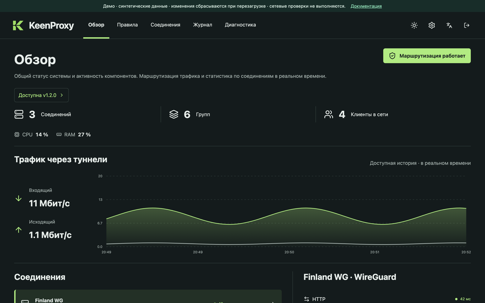
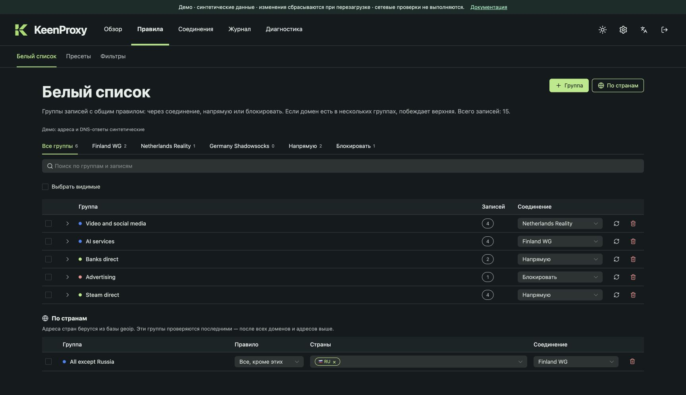
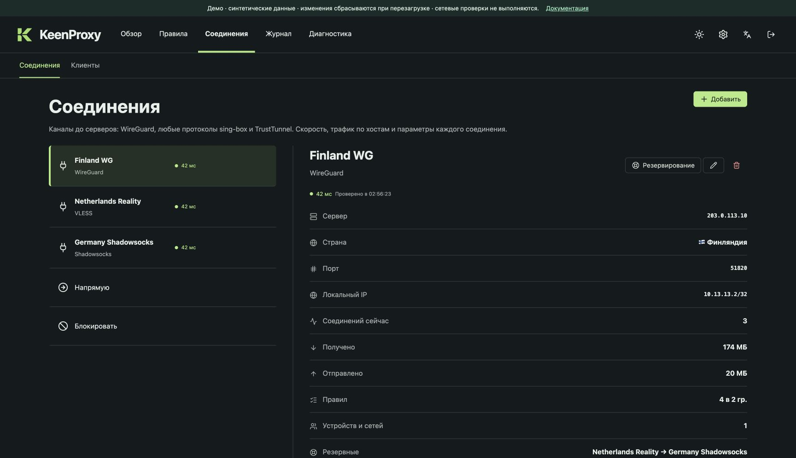
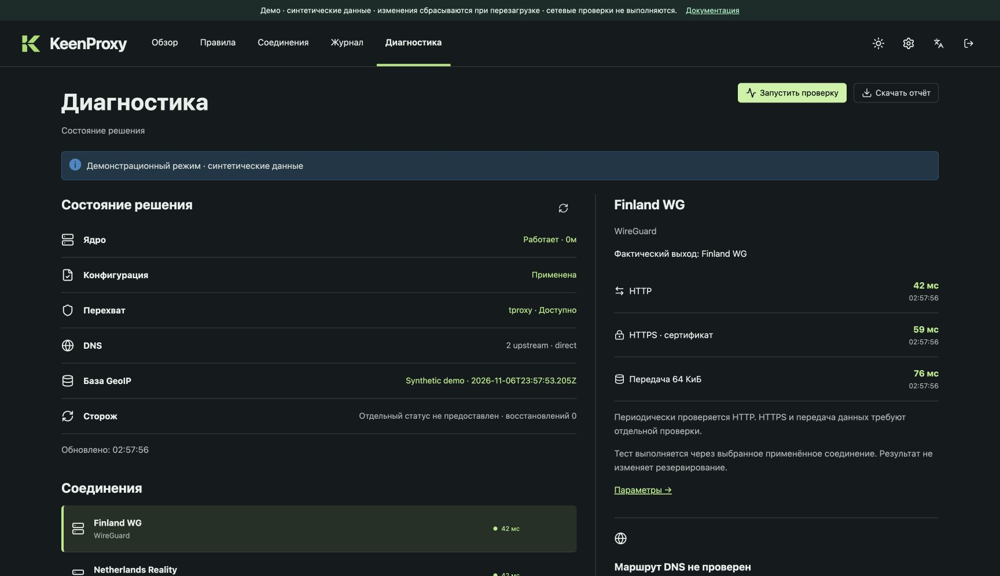

<section class="kp-hero" markdown>

{ .kp-hero__logo width="72" }

# Ваша сеть — ваши маршруты

Выборочная маршрутизация трафика для роутеров Keenetic и Netcraze с Entware. Выбирайте, какие устройства, домены, адреса и страны идут через туннель, напрямую или блокируются, — в одной веб-панели.

[:material-play: Открыть демо](../demo/){ .md-button .md-button--primary }
[Начать работу](getting-started.md){ .md-button }

[{ .kp-hero__shot }](../demo/)

</section>

<section class="kp-section" markdown>

## Возможности

:material-devices:{ .kp-card__icon }

### Политики для устройств и сетей

Раздельная маршрутизация, полный туннель или прямой доступ для сети и отдельные правила для устройств по MAC-адресу.

:material-earth:{ .kp-card__icon }

### Группы доменов, IP и стран

Маршрутизация по домену, CIDR или стране — в том числе с исключениями вроде «всё, кроме России».

:material-vpn:{ .kp-card__icon }

### Разные типы соединений

WireGuard, ссылки подключения sing-box, outbound-объекты sing-box и необязательный клиент TrustTunnel.

:material-shield-sync:{ .kp-card__icon }

### Резервирование

Переход на другое соединение при отказе и возврат после восстановления.

:material-dns:{ .kp-card__icon }

### DNS и блок-листы

Локальный DNS-фронтенд с резолверами DoH/DoT, выбором маршрута для DNS и блок-листами на уровне DNS.

:material-file-document-check-outline:{ .kp-card__icon }

### Проверка перед применением

Все изменения попадают в общий черновик. Примените его, когда готовы, или отмените; журналы объясняют результат.

</section>

<section class="kp-section" markdown>

## Как это работает

### Добавьте соединение

Импортируйте файл WireGuard или ссылку подключения либо воспользуйтесь мастером.

### Создайте группы

Соберите домены, адреса или страны и выберите, куда их направить.

### Выберите устройства и примените

Укажите, какие сети и клиенты следуют правилам, и примените черновик.

KeenProxy также следит за своими правилами перехвата. На совместимых прошивках Keenetic/Netcraze хук netfilter запускает проверку после изменений firewall; периодический сторож работает везде, включая экспериментальные установки OpenWrt. [Как устроено восстановление правил](network-flow.md#как-восстанавливаются-правила-после-изменений-прошивки).

</section>

<section class="kp-section" markdown>

## Как выглядит панель

<figure markdown>

<figcaption>Правила</figcaption>
</figure>

<figure markdown>

<figcaption>Соединения</figcaption>
</figure>

<figure markdown>

<figcaption markdown>Диагностика. [Как скачать ZIP на роутере](troubleshooting.md#download-the-diagnostic-zip).</figcaption>
</figure>

</section>

<section class="kp-cta" markdown>

## Попробуйте в браузере

Демо запускает настоящую веб-панель с синтетическими данными. Роутер и учётные данные не нужны.

[:material-play: Открыть демо](../demo/){ .md-button .md-button--primary }
[Читать обзор](overview.md){ .md-button }

KeenProxy — экспериментальный проект. Совместимость зависит от архитектуры роутера, прошивки, возможностей ядра и состава сборки.

</section>

