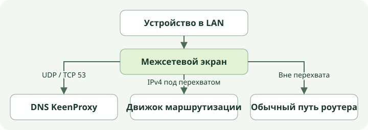
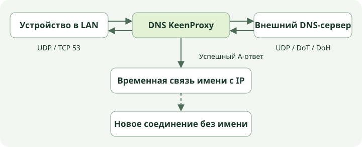
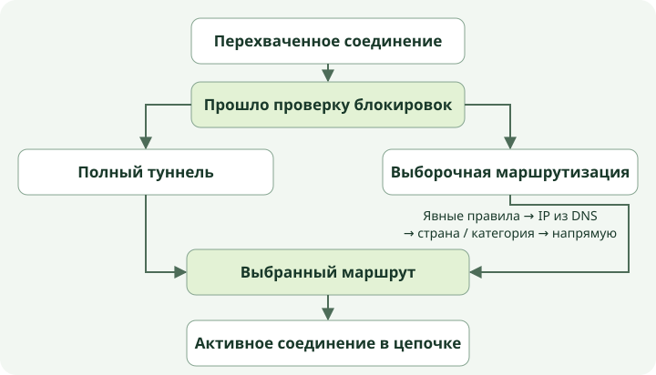

# Как трафик проходит через KeenProxy

Разберём два обмена от устройства в локальной сети: запрос DNS и соединение с сайтом. По пути видно, какой трафик попадает в KeenProxy, как выбирается выход и где искать причину сбоя.

## Где происходит перехват

KeenProxy работает на роутере Keenetic или Netcraze. Устройства используют свой обычный шлюз и могут открывать соединения без настройки прокси в приложениях. Когда пакет IPv4 приходит на настроенный интерфейс локальной сети, межсетевой экран решает, передать ли его локальному обработчику KeenProxy или пропустить обычным путём.

| Что приходит на интерфейс локальной сети | Что делает роутер |
| --- | --- |
| UDP или TCP на порт 53 | Перенаправляет запрос в DNS KeenProxy, даже если устройство отправило его на адрес самого роутера или публичного DNS-сервера. Правило действует на всём настроенном интерфейсе независимо от политики устройства. |
| TCP от участвующего устройства к адресу вне диапазонов обхода | Передаёт соединение в sing-box через REDIRECT. Движок узнаёт исходное назначение и открывает отдельное исходящее соединение. |
| Остальной UDP от участвующего устройства | В режиме TPROXY подходящие пакеты помечаются и доставляются локальному обработчику без подмены адреса назначения. В режиме REDIRECT обычный UDP не попадает под перехват трафика приложений. |
| Транзитный UDP на порт 443 от участвующего устройства | Отклоняется в обоих режимах. Браузеры обычно повторяют попытку по TCP, но приложение, которому нужен QUIC, может перестать работать. |
| Трафик вне области перехвата | Идёт обычным путём роутера. Сюда относятся локальные диапазоны обхода для трафика приложений и IPv6, которого этот перехват IPv4 не касается. При прямом обмене внутри LAN пакеты могут вовсе не попасть в эти правила. |

Политика сети сопоставляется с подсетью источника. Исключение для устройства задаётся по MAC-адресу, а для обработки трафика используется текущий IPv4-адрес из таблицы соседей роутера или статический адрес из настроек. Политика **Не участвует** исключает устройство из перехвата приложений, но не из общего правила DNS. Трафик, который создаёт сам роутер, не входит через интерфейс LAN и не попадает в эти правила перехвата.

При запуске KeenProxy сначала поднимает движок и обработчики DNS, затем включает перехват. При штатной остановке он первым снимает перехват. Во время работы KeenProxy проверяет, не удалил ли роутер его правила межсетевого экрана, и пытается восстановить их при необходимости. После штатной остановки действуют обычные правила роутера. Отказ отдельного туннеля при работающем KeenProxy обрабатывается по цепочке резервов.

## DNS и соединение с сайтом идут отдельно

1. Запрос принимает DNS KeenProxy. Если имя заблокировано DNS-правилом, ответ формируется локально. Когда включено подавление AAAA, обработчик может вернуть пустой ответ на запрос IPv6-адреса.
2. Для остальных запросов KeenProxy перебирает настроенные резолверы по порядку. UDP, DNS over TLS (DoT) и DNS over HTTPS (DoH) определяют обмен **от роутера до резолвера**. Между устройством и роутером при этом может идти обычный DNS. В настройках можно отправлять запросы к резолверу напрямую или через выбранное соединение. Если у резолвера задан bootstrap IP, роутер использует его для подключения без отдельного запроса имени, а TLS по-прежнему проверяет имя сервера.
3. Если у DNS-соединения есть цепочка резервов, используется выбранный сейчас туннель. Когда цепочка переключается на «Напрямую», DNS не использует этот выход автоматически. Прямая попытка разрешена только отдельной настройкой отказа DNS. Без неё при недоступности туннельного пути клиент получит ошибку DNS. В старой конфигурации без явно заданного маршрута DNS возможен отдельный резерв на системный резолвер.
4. KeenProxy возвращает ответ клиенту. Из успешных ответов он может запомнить соответствие имени и IPv4-адреса, в том числе через псевдонимы CNAME. Он также сам разрешает активные настроенные имена в фоне. У записей есть срок жизни по DNS TTL. Движок перечитывает эти правила асинхронно, поэтому изменения в кеше могут влиять на трафик с небольшой задержкой.

Затем приложение само открывает соединение к IP-адресу и порту. Имя иногда видно в заголовке HTTP Host незашифрованного запроса или в TLS SNI. KeenProxy использует это имя для выбора правила и сохраняет исходное назначение. IP из DNS используются только тогда, когда в самом соединении **нет читаемого имени**. Если имя видно, но не совпало ни с одним правилом по домену, повторного поиска по IP из DNS не будет. Общие адреса CDN, устаревшие ответы и запросы, которых DNS KeenProxy не видел, ограничивают точность такого сопоставления.

## Как движок выбирает выход

1. Движок ищет имя в начале перехваченного соединения. Сначала он пропускает напрямую приватные назначения, затем применяет общие правила блокировки к остальному трафику. Эти проверки идут перед политиками устройств и сетей.
2. Политика устройства имеет приоритет над политикой сети. **Полный туннель** после общих проверок использует выбранное соединение. В режиме **Раздельный** сначала идут явные группы доменов и IP, затем IP из DNS для соединений без имени, затем группы стран и категорий. Если совпадений нет, трафик идёт напрямую.
3. По выбранному маршруту движок открывает прямое соединение либо использует прокси или туннель. Трафик в обход перехвата и прямой маршрут через движок могут выйти в интернет без VPN, но только во втором случае движок выбирал правило. Для прокси или туннеля роутер подключается к настроенному удалённому узлу, который переносит или пересылает трафик к исходному назначению.

Допустим, явное правило **Магазин → Напрямую** совпадает с доменом, а более широкое правило отправляет трафик за пределы выбранной страны через туннель. При видимом SNI `store.example` первым сработает правило магазина. Если второе соединение идёт на тот же IP без имени, правило магазина всё ещё может сработать по сохранённому DNS-ответу. Если записи и явного правила для IP нет, может сработать правило страны. При ECH видимое внешнее имя SNI может отключить резерв по DNS, хотя настоящее внутреннее имя скрыто.

## Что происходит при отказе соединения

Правило может выбрать соединение с упорядоченной цепочкой резервов. Само правило остаётся прежним, но KeenProxy меняет соединение, через которое отправляет трафик. Для проверки он периодически выполняет HTTP-запрос через каждое соединение. Если активное соединение не отвечает дольше заданного порога, выбирается первый доступный резерв. Возврат к более приоритетному соединению происходит после устойчивого восстановления. Если доступных альтернатив нет, текущий выбор сохраняется. Прямой выход возможен, только если его явно добавили в цепочку.

При переключении действующие соединения могут закрыться, и клиенту придётся подключиться заново. Проверка показывает доступность тестового URL и время ответа. Она не подтверждает работу конкретного сайта, UDP-приложения или DNS-резолвера через то же соединение.

## Как проследить один запрос

| Что нужно выяснить | Где смотреть |
| --- | --- |
| Каким путём прошёл DNS | Откройте диагностику DNS и системный журнал. Проверьте маршрут резолвера и факт прямого резерва. Блокировка TCP/UDP на порту 853 не перехватывает DoH приложений по HTTPS на порту 443. |
| Какое правило и выход выбраны | Повторите запрос с нужного устройства и откройте **Журналы → Маршрутизация**. Сверьте клиента, назначение, правило и выход. Решение может попасть в журнал, даже если запрос до удалённого сервера не дошёл. |
| Работает ли соединение до самого сервера | Запустите проверку HTTPS или передачи данных и повторите запрос в самом приложении. Для проверки DNS-утечек смотрите внешний трафик роутера при запросах с нужного устройства, в том числе при отказе туннеля. |

Настройка политик описана в разделе [«Маршрутизация и DNS»](routing.md), дополнительные проверки — в разделе [«Диагностика и вопросы»](troubleshooting.md).
