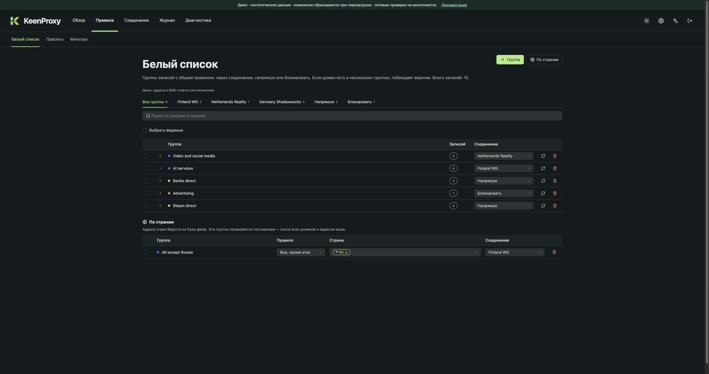
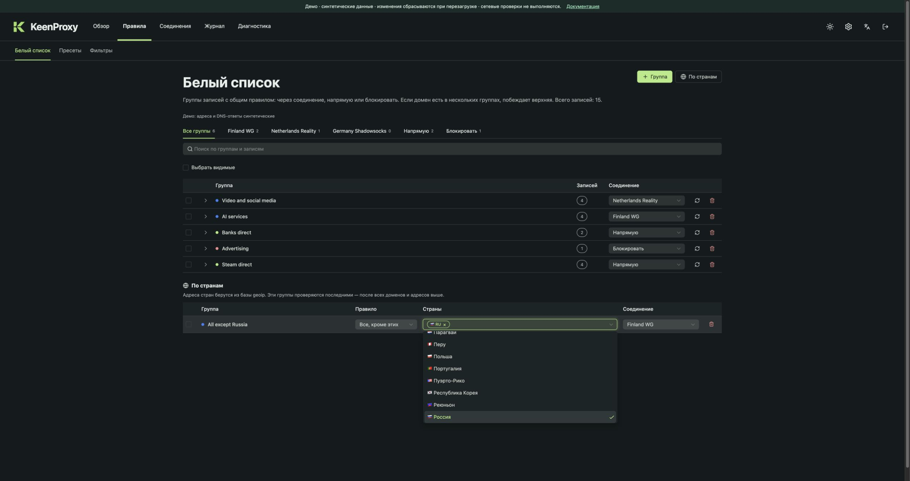

# Маршрутизация и DNS

## Из чего состоит политика

| Элемент | Назначение |
| --- | --- |
| Соединение | Именованный туннель/прокси, доступный как целевой маршрут |
| Группа | Список доменов/адресов или выбор стран с маршрутом |
| Напрямую | Подключение без настроенного туннеля |
| Блокировать | Запрет подходящего трафика |
| Сеть | Политика по умолчанию для подсети |
| Клиент | Политика конкретного устройства по MAC-адресу |

Режим стран **Кроме** описывает трафик за пределами выбранных стран. Явные доменные списки и правила стран задают разные уровни политики; проверяйте журнал, чтобы узнать, какое правило сработало для конкретного запроса.

## Правила по странам { #country-rules }

Группы стран сопоставляют **IP-адрес назначения** с базой GeoIP. Они не определяют гражданство пользователя, язык сайта или страну по доменному суффиксу. Выбор страны также не выбирает выходной сервер: маршрут отдельно задаётся в колонке **Соединение**.

### Всё, кроме России, через туннель

1. Создайте или импортируйте рабочее соединение, затем откройте **Правила → Белый список**.
2. Нажмите **По странам**. Новая группа создаётся с выбранной Россией (`RU`) и режимом **Все, кроме этих**. При необходимости нажмите на имя группы, чтобы переименовать её.
3. В колонке **Страны** оставьте `RU` или добавьте другие страны-исключения. Режим **Только эти страны** позволяет, наоборот, сопоставлять только выбранные страны.
4. В колонке **Соединение** выберите профиль, например **Finland WG**. **Напрямую** обходит туннель, **Блокировать** запрещает подходящий трафик.
5. Откройте **Соединения → Клиенты** и убедитесь, что нужная сеть или устройство использует режим **Раздельный**. Проверьте общий черновик и один раз нажмите **Применить**.

В браузерном демо уже есть группа **All except Russia → Finland WG**. Её можно изменить и применить; перезагрузка страницы сбрасывает синтетическую сессию.

Откройте список стран для поиска по названию или ISO-коду. Выбранные страны отображаются метками с кодами; удаление метки меняет черновик.

### Какое правило побеждает

Глобальные блокирующие группы проверяются первыми. В маршрутизируемой политике устройства или сети явные группы доменов и адресов проверяются раньше групп стран. Настройки устройства приоритетнее настроек сети. Режим **Полный туннель** использует выбранное соединение по умолчанию и отличается от описанной здесь выборочной маршрутизации.

| Пример в конфигурации демо | Результат |
| --- | --- |
| Домен Steam совпал с группой **Steam direct** | Напрямую, даже если IP назначения находится за пределами России |
| Домен совпал с группой **Video and social media** | Netherlands Reality, раньше общего правила по странам |
| Более ранних совпадений нет, IP назначения вне `RU` | Finland WG |
| Более ранних совпадений нет, IP назначения в `RU` | Правило стран-исключений не совпадает; выборочная политика использует прямой маршрут |

**Все, кроме этих** — инверсия условия, а не принудительный прямой маршрут для выбранных стран. Более раннее явное правило по-прежнему может направить российский адрес через другое соединение. Конкретные исключения задавайте группами доменов или адресов.

### Проверка результата

На реальной установке проверьте загрузку базы стран в **Диагностике**, примените конфигурацию и найдите выбранное соединение и сработавшее правило в **Журнале → Маршрутизация**. До загрузки GeoIP нельзя полагаться на правила стран. Адреса CDN и обновления базы могут менять страну IP; для важных исключений используйте явные домены или адреса.

Демо показывает синтетическую загруженную базу и примеры записей журнала. Оно демонстрирует редактирование и применение, но не выполняет GeoIP-поиск и не проверяет реальный сетевой трафик.

## Базы стран

Группы по странам используют базы MMDB, которые настраиваются в разделе **Правила → Базы стран**. Порядок в списке — это приоритет: страну адреса определяет первая включённая база, которая его знает, и правила стран следуют тому же порядку. Встроенные источники можно включать, выключать и переставлять. Можно добавить свою базу: HTTPS-ссылку на `.mmdb`, `.mmdb.gz` или `.tar.gz` (`{month}` заменяется на `ГГГГ-ММ`, при отсутствии берётся прошлый месяц) либо абсолютный путь к файлу на роутере.

Роутер проверяет включённые базы раз в сутки. Файлы скачиваются только по HTTPS, сверяются с опубликованной суммой SHA-256, если источник её даёт, проверяются как база стран MMDB и подменяются атомарно. При ошибке прежний файл остаётся, повтор — через 10 минут, затем пауза удваивается до 6 часов. После изменения списка проверка начинается сразу после **Применить**.

Базы категорий — второй вид баз адресов. Вместо стран они помечают сети метками, например `RU-BLOCKED`, `RE-FILTER` или `TELEGRAM`, и в определении стран не участвуют. В группах метки выбираются в поле **Категории** — отдельно или вместе со странами и режимом **Все, кроме этих**. Включённые базы категорий объединяются: метка срабатывает, если её сообщает любая из них. Встроенные источники runetfreedom хранят у каждой сети только одну метку, поэтому сеть из нескольких исходных списков попадёт только в одну категорию. Для групп с категориями нужна хотя бы одна включённая база категорий.

**Проверить адрес** показывает ответ каждой базы. Выключенную базу можно скачать и проверить отдельно — на маршрутизацию это не влияет. Проверка показывает только содержимое баз, а не то, какое правило сработало для реального соединения.

## Резервные цепочки

Соединение может ссылаться на другое соединение или прямой выход как непосредственный резерв. Интерфейс показывает получившуюся цепочку. Меняется ближайший резерв выбранного профиля; следующие унаследованные переходы принадлежат своим профилям. Избегайте циклов. Прямой выход в качестве резерва намеренно разрешает прямой маршрут при отказе основного.

Периодическая проверка измеряет HTTP-запрос, а не ICMP-пинг. Она независима от ручных HTTPS-проверок и проверки передачи в Диагностике.

## DNS

Настройки DNS определяют резолверы и маршрут запросов: напрямую или через соединение. Bootstrap-адреса помогают разрешать имена шифрованных DNS-серверов. Политика отказа задаёт, разрешён ли прямой DNS при проблемах выбранного пути. Списки фильтрации и исключения меняют DNS-ответы, а не все возможные виды трафика приложения.

Проверяйте перехват UDP/TCP и обработку шифрованного DNS на реальной тестовой сети роутера. Приложения могут использовать собственные резолверы. Интерфейс и демо не доказывают универсальную защиту от DNS-утечек.

Скриншоты находятся в [руководстве](user-guide.md), объяснения результатов — в [диагностике и вопросах](troubleshooting.md).
