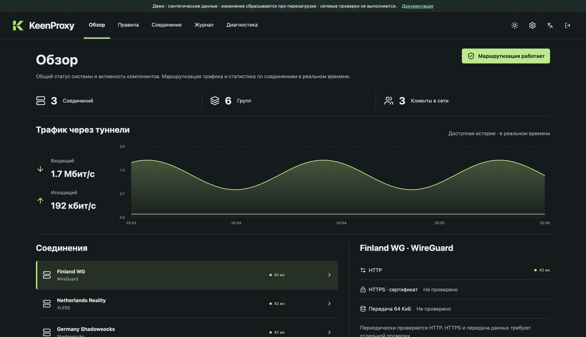
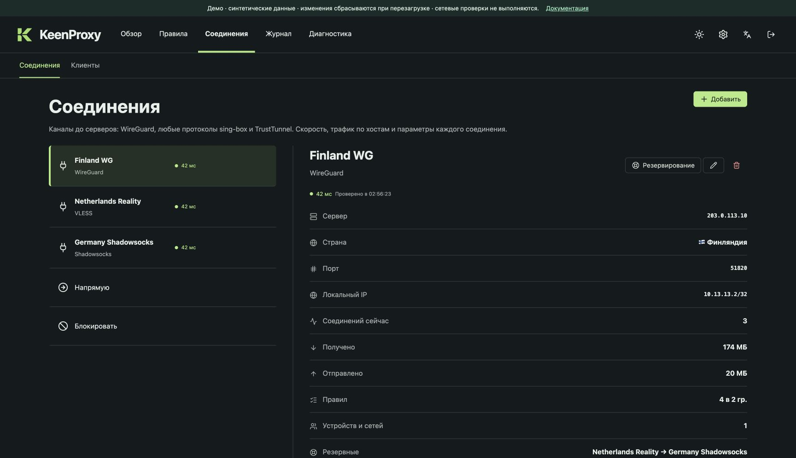
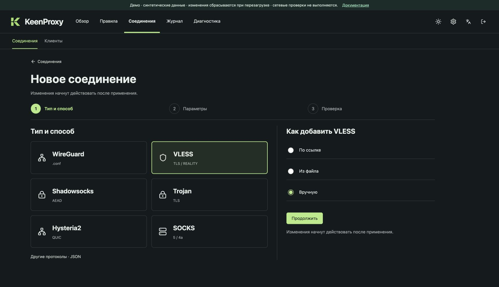
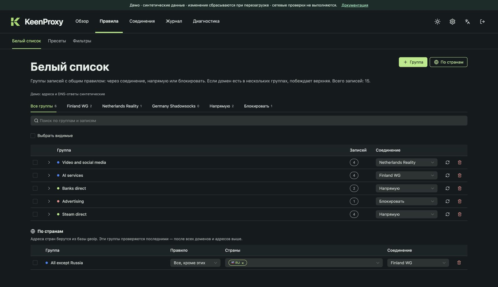
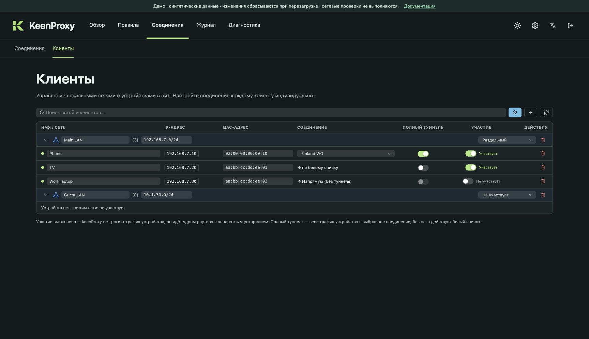
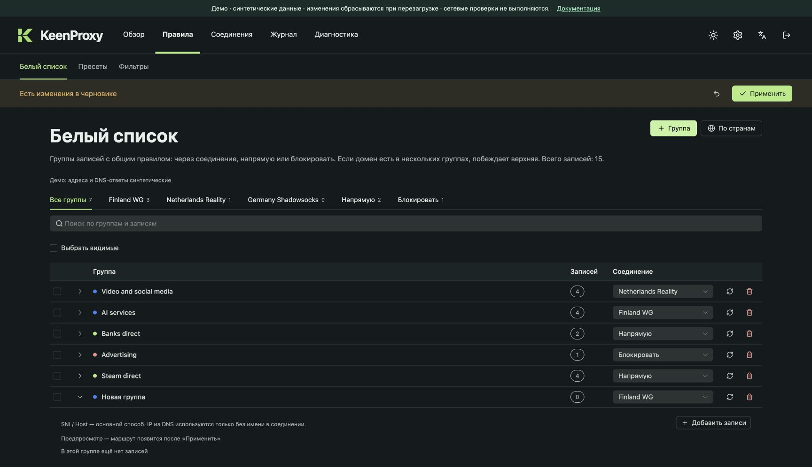
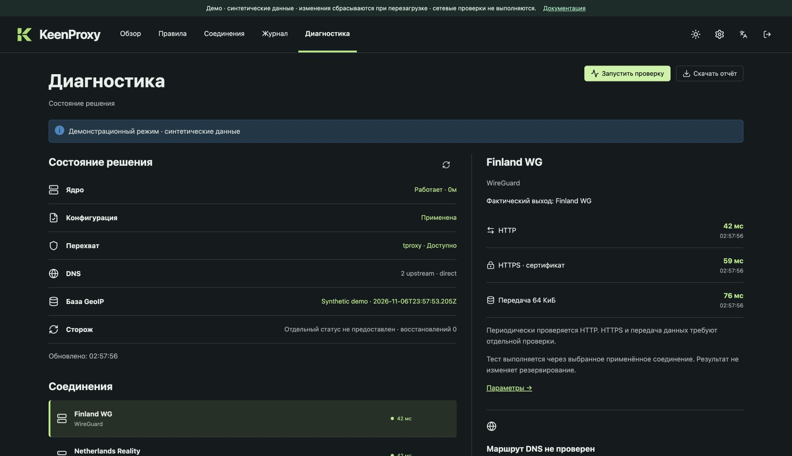
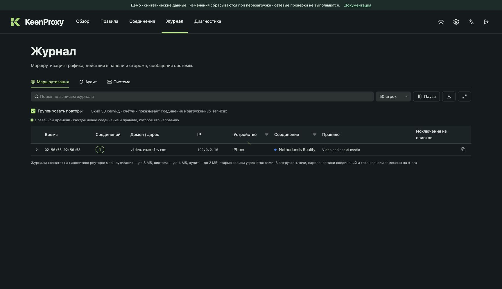
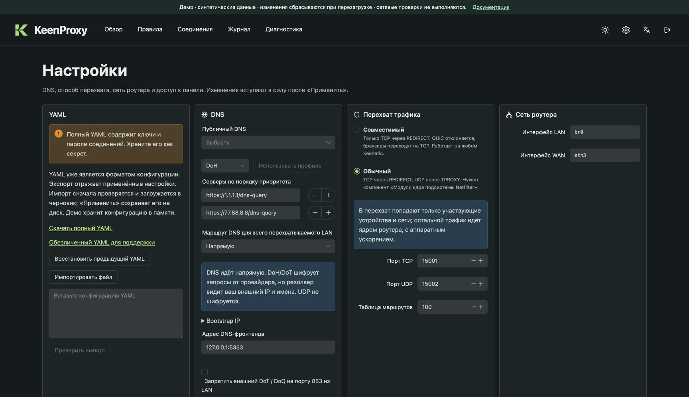

# Руководство пользователя

На скриншотах — те же Vue-экраны, которые входят в KeenProxy, запущенные в отдельном браузерном демо. Адреса, счётчики, профили и результаты синтетические. Руководство описывает реализованный интерфейс, а не обещает все возможности исторических макетов.

## 1. Посмотрите обзор

Откройте **Обзор**. Проверьте состояние соединений, текущий трафик и переходы к правилам, клиентам и диагностике. Графики отражают наблюдаемую активность; сами по себе они не проверяют приватность или утечки.

## 2. Настройте соединение

Откройте **Соединения**. Выберите профиль, чтобы посмотреть параметры и состояние. Нажмите **Добавить** для открытия мастера: импортируйте поддерживаемую ссылку/файл или задайте поддерживаемый протокол вручную. Выберите понятное имя, проверьте протокол и адрес сервера перед подтверждением.

Изменения попадают в общий черновик. Настоящие реквизиты следует вводить только в локальном сеансе управления своим роутером. В браузерном демо используйте синтетические значения.

## 3. Добавьте группу маршрутизации

Откройте **Правила → Белый список**. Создайте группу, задайте имя, выберите целевое соединение либо **Напрямую**/**Блокировать**, добавьте домены или адреса. Например, направьте `work.example.com` через профиль Netherlands. Проверьте импортируемые записи перед подтверждением; выбор стран задаёт более широкую политику.

Раскройте запись, чтобы посмотреть DNS-наблюдения и срок действия адресов. Наличие IP само по себе не доказывает, что трафик приложения прошёл через нужный туннель.

## 4. Попробуйте пресет

Откройте **Правила → Пресеты**, выберите маршрут и предпросмотр набора. Изучите добавляемые/удаляемые записи и перенесите результат в черновик. Пресеты можно включать, выключать и удалять. Статическое демо содержит один собственный пример набора, а не полный каталог сообщества.

## 5. Выберите устройства и сети

Откройте **Соединения → Клиенты**. Настройки сети задают политику для подходящей подсети; записи устройств позволяют выбрать её для отдельных клиентов. **Раздельный** использует избирательные правила, **Полный туннель** выбирает соединение по умолчанию, **Не участвует** отключает перехват KeenProxy для этой политики. Перед применением проверьте и устройство, и сеть.

## 6. Проверьте и примените

Панель изменений появляется, когда черновик отличается от сохранённой конфигурации. Просмотрите правки на всех экранах и один раз нажмите **Применить**. Дождитесь успеха. При ошибке проверки/применения прочитайте сообщение и исправьте черновик. **Отменить** восстанавливает последний сохранённый снимок.

## 7. Проверьте результат

Откройте **Диагностику**, выберите применённое соединение и запустите проверки. Рассматривайте HTTP, HTTPS с проверкой сертификата и передачу данных отдельно. Изменённое соединение нужно сначала применить, чтобы проверять его через работающий движок. В демо результаты явно помечены как синтетические.

В **Журнале** смотрите решения маршрутизации, события аудита/изменения конфигурации или системные ошибки. Поиск и доступные фильтры сужают выборку в приложении на роутере. Решение маршрутизации показывает выбранный выход, но не подтверждает успешное соединение или передачу. Статическое демо выдаёт примеры записей без живого потока событий.

## 8. DNS и резервные копии

Откройте **Настройки**: там находятся DNS-провайдеры, маршруты и политика отказа, общие параметры, язык, резервные копии и предпросмотр конфигурации. Импорт или восстановление подготавливает черновик: проверьте его и примените. Полные резервные копии держите приватными. Браузерное демо экспортирует только синтетическую JSON-совместимую конфигурацию и намеренно не поддерживает импорт YAML.

